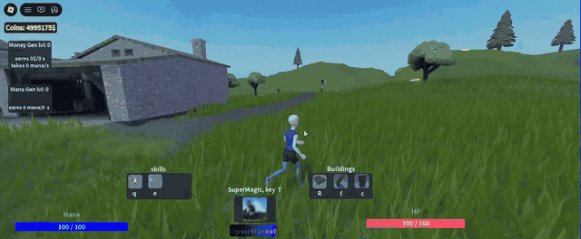

# Arcane Orchard RPG

**A co-op Roblox magic RPG with a server-authoritative economy, data-driven enemy AI and a Rojo + CI toolchain.**



Players earn coins from generators, apple trading and enemy kills, unlock spells in the shop and fight archers and magicians that patrol the map. Full-length captures: [NPC combat](media/npc-combat.gif) · [Super Magic](media/super-magic.gif) · [shop](media/shop-ui.png) · [skills](media/skills-ui.png) · [world](media/world-overview.png).

## What I built

- **Spell system**: 7 spells (Fireball, Ice Arrow, Spikes, Wall, Floor, Stairs, Super Magic). Projectiles move on one Heartbeat stepper and raycast between frames, so fast spells do not pass through targets.
- **Server-authoritative shop**: the client sends only an item id; the server owns prices, unlocks and generator levels.
- **Resource economy**: mana regeneration, a mana generator, a money generator that converts mana into coins, and an apple market with a shared price that changes every 30 seconds.
- **Enemy AI**: one `NpcBrain` module drives every enemy type from config (detection radius, attack list with ranges, reward). Patrol uses `PathfindingService` with a fallback when no path is found.
- **Persistence**: money, mana, unlocks and generator levels saved with `DataStoreService`.
- **Combat rules**: one `Combat` module decides who can damage whom (no NPC friendly fire, PvP behind a flag) and tags the attacker for kill rewards.
- **Building spells**: walls, floors and stairs face the caster, expire after 45 s and are capped per player.
- **Tooling**: Rojo project, `--!strict` Luau with type annotations, Selene, StyLua, unit tests for the economy rules, GitHub Actions CI.

## Controls

| Key | Spell | Key | Spell |
| --- | --- | --- | --- |
| `Q` | Fireball | `C` | Wall |
| `E` | Ice Arrow | `R` | Floor |
| `X` | Spikes | `F` | Stairs |
| `T` | Super Magic | | |

Spikes, buildings and Super Magic are aimed with the mouse. Spells are unlocked in the shop (**Open Market** button).

## Architecture

```text
 CLIENT (StarterPlayerScripts)                SERVER (ServerScriptService)
 ─────────────────────────────                ──────────────────────────────────────
 SpellInput ── CastSpell(id, target?) ──────▶ SpellService
 ShopController ── PurchaseItem(id) ────────▶ ShopService ─▶ AppleMarket
 ShopController ── SellApple() ─────────────▶ AppleMarket
                                                │ 1. rate limit
                                                │ 2. validate argument types
                                                │ 3. check rules (unlocked, cooldown,
                                                │    range, price, level cap)
                                                ▼
                                              PlayerData (session state, DataStore)
                                                │ 4. change state
                                                ▼
 Hud / ShopController / SpellInput ◀───────── Player attributes (Money, Mana,
   re-render on attribute change               Unlocked_<spell>, generator levels)
                                               replicate to the owning client
 ShopController ◀── Notify(message) ───────── feedback text only, never state
```

- `src/shared` (ReplicatedStorage.Shared): config modules used by both sides. Spell costs, cooldowns, prices, generator rates and enemy archetypes each have **one** definition, so the shop, the hotbar and the server checks cannot disagree.
- `src/server` (ServerScriptService): `Main.server.luau` starts the services in order. Services are plain ModuleScripts with a `start()` function.
- `src/client` (StarterPlayerScripts): controllers only render replicated state and send requests.
- `places/ArcaneOrchardRPG.rbxlx`: the map, UI layouts and art prefabs (spell models, enemy rigs, apple tool). Prefabs are treated as visuals; any server script inside them is removed on clone so behaviour lives only in `src/`.

## Security & data

- **No client-trusted values.** Remotes carry ids and an aim point only. Prices, mana costs, cooldowns and damage come from config on the server.
- **Every remote is validated**: per-player token-bucket rate limit, `typeof` checks, finite-number checks for `Vector3`, range check against the character position, unlock and cooldown checks. Mana is spent only after all checks pass.
- **Resources tick on the server.** Generator levels change only through a validated purchase.
- **Apple trading** removes the apple before paying, so a repeated request cannot sell the same apple twice.
- **DataStore**: `GetAsync` and `UpdateAsync` with retries and exponential backoff. If loading fails, the player plays on a default profile flagged `canSave = false`, so an outage never overwrites real progress. Saved data is validated on load (types, ranges, known spell ids). Saves run on leave, on a 60 s autosave for changed profiles and in `BindToClose` (waits for in-flight saves). Studio sessions do not touch DataStores.
- **Bounded server load**: built structures expire and are capped per player, spell effects clean themselves up, and per-player tables are cleared on `PlayerRemoving`.

## How to run

Requirements: Roblox Studio, [Rokit](https://github.com/rojo-rbx/rokit) (or Rojo 7.5 installed another way) and the Rojo Studio plugin. The place file is stored with Git LFS.

```bash
git lfs install
git clone https://github.com/CondrusArsen/arcane-orchard-rpg.git
cd arcane-orchard-rpg
rokit install          # rojo, selene, stylua, luau-lsp at the pinned versions
rojo serve
```

1. Open `places/ArcaneOrchardRPG.rbxlx` in Roblox Studio.
2. In the Rojo plugin, click **Connect**. The code from `src/` is synced into the place.
3. One time only: paste `tools/clean-place.luau` into the Studio command bar and press Enter. It removes the scripts that were stored inside the place before the code moved to `src/`, then save the place.
4. Press **Play**.

Checks that CI runs (`.github/workflows/ci.yml`):

```bash
stylua --check src tools tests
selene src tools tests
rojo sourcemap default.project.json -o sourcemap.json
luau-lsp analyze --sourcemap=sourcemap.json --definitions=globalTypes.d.luau src tests
luau tests/Economy.spec.luau
```

The enemy rigs use the default Roblox `Animate` script; the apple tool, orchard trees, mill and smithy bellows are Roblox template assets with their own small scripts, kept in the place file.

## Built with an AI-assisted workflow

I designed the game, its systems and the architecture, and I reviewed and tested every change. I use AI coding assistants to speed up implementation and refactoring, the same way I use linters and type checking: as tools, with the decisions and the final review done by me.

## Known limitations / next steps

- No cross-server session locking yet: the next step is moving `PlayerData` to ProfileStore.
- Keyboard and mouse controls only; touch and gamepad bindings are planned.
- Unit tests cover the pure economy rules; server services are verified by manual playtests in Studio (see [docs/TESTING.md](docs/TESTING.md)).
- Publish the place and add a public "Play" link.
