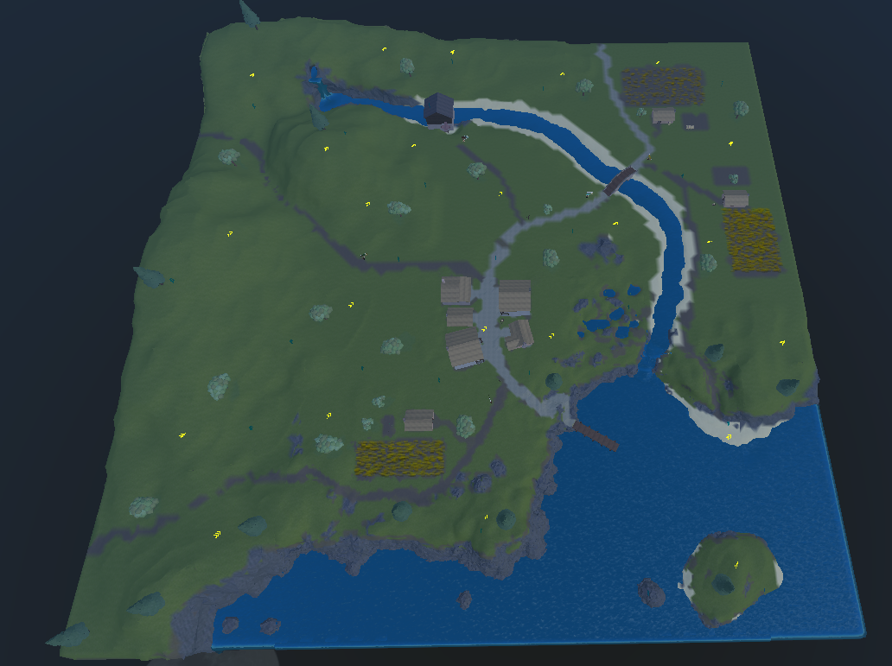
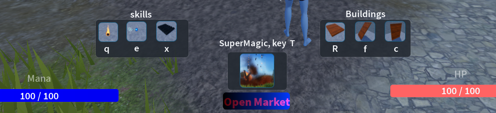

# Arcane Orchard RPG

Arcane Orchard RPG is a Roblox RPG prototype focused on magic combat, NPC encounters, resource collection, and a small upgrade economy. The project started as a learning game built together with a child and was later cleaned up into a portfolio-ready prototype with safer server logic, clearer UI, and extracted Luau scripts for review.

## Project Highlights

- Medieval/fantasy Roblox world with fields, orchard trees, structures, props, boosters, and NPC patrol routes.
- Magic system with fireball, ice arrow, spikes, buildable wall/floor/stairs, and a Super Magic meteor attack.
- Server-authoritative spell casting, mana spending, shop purchases, apple buying/selling, and money generation.
- NPC archers and magicians with patrol behavior, player detection, pathfinding, attacks, death rewards, and respawn flow.
- Shop and skill UI with static Roblox GUI properties, not runtime-only styling.
- Basic player persistence for money and mana in published servers, with Studio-safe DataStore fallback.

## Gameplay Preview

### World



### Shop And Skills




### Combat

<details>
<summary>Super Magic demo</summary>


</details>

<details>
<summary>NPC combat demo</summary>


</details>

## Controls

| Key | Ability |
| --- | --- |
| `Q` | Fireball |
| `E` | Ice Arrow |
| `X` | Spikes |
| `C` | Wall |
| `R` | Floor |
| `F` | Stairs |
| `T` | Super Magic |

Abilities must be unlocked from the in-game shop before they appear in the skill UI.

## Repository Structure

```text
.
├── places/
│   └── ArcaneOrchardRPG.rbxlx
├── src/
│   ├── extracted-scripts/
│   └── scripts_manifest.json
├── docs/
│   ├── CHANGELOG.md
│   ├── PROJECT_OVERVIEW.md
│   ├── SCRIPT_INVENTORY.md
│   └── TESTING.md
├── media/
│   └── README.md
└── tools/
```

## How To Open

1. Open Roblox Studio.
2. Choose `File -> Open from File`.
3. Select `places/ArcaneOrchardRPG.rbxlx`.
4. Press `Play` to test the prototype.

When testing in Studio, DataStore persistence is intentionally skipped to avoid local API permission errors. In a published Roblox experience, the same save script can use DataStoreService.

## What Was Cleaned Up

- Replaced an unsafe Super Magic loop with a capped meteor burst.
- Restored Super Magic explosions while preventing map destruction.
- Moved UI styling into saved `StarterGui` properties.
- Replaced duplicated booster scripts with shared controllers.
- Added server-side validation for economy and spell events.
- Hardened apple healing, NPC rewards, projectile cleanup, and shop unlocks.
- Replaced an inaccessible animation asset with a safe fallback.

See [docs/CHANGELOG.md](docs/CHANGELOG.md) for the full cleanup log.

## Portfolio Notes

This is best presented as a polished prototype, not a finished commercial game. The value of the project is in the breadth of Roblox systems it touches: client/server events, GUI work, NPC AI, pathfinding, combat effects, economy, persistence, tools, and world scripting.

The GIFs are intentionally kept as short gameplay captures. If the repository is cloned locally, Git LFS is recommended for downloading the larger media files and the Roblox place file cleanly.
